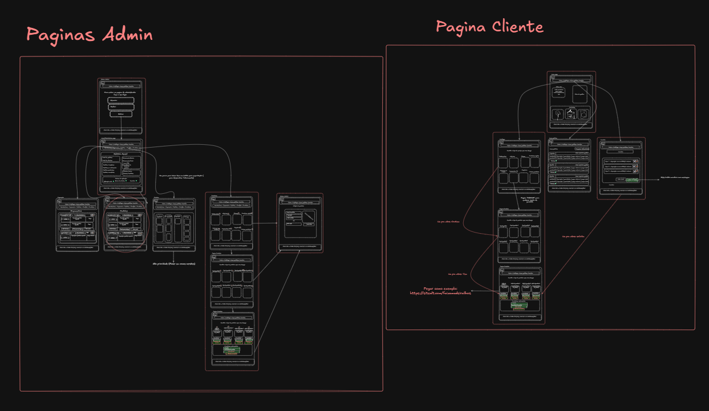
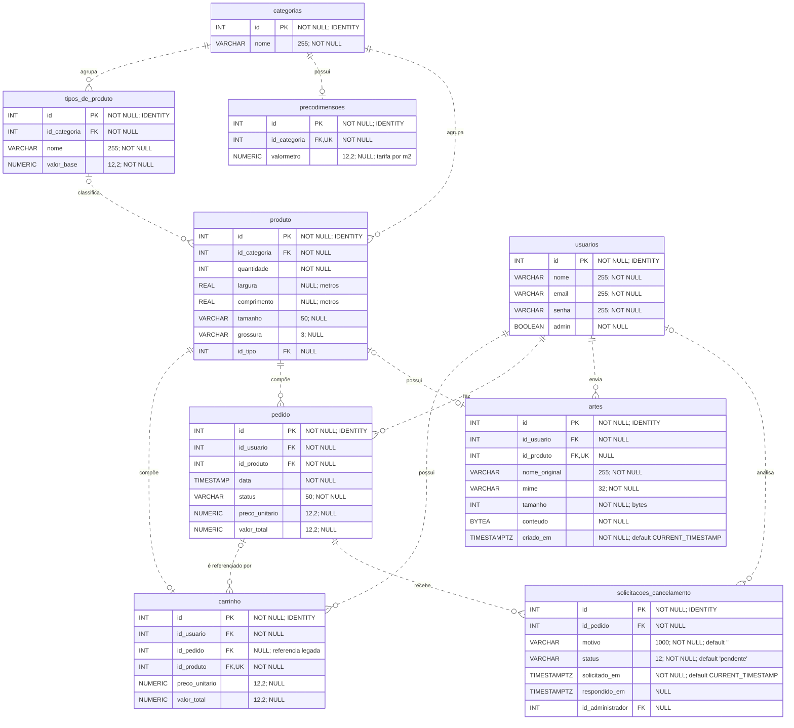

# ArtUP

Aplicação web para uma gráfica: clientes configuram produtos, calculam preços, enviam artes e confirmam pedidos; administradores gerenciam preços, produção, cancelamentos e estatísticas.

O projeto usa **PHP procedural, HTML/CSS e PostgreSQL via PDO**, com páginas renderizadas no servidor. Não há framework, autoload do Composer, build de frontend ou integração de pagamento no código atual.

## Funcionalidades e fluxo

1. Cadastre uma conta em `login/cadastrar.php` e entre em `login/login.php`.
2. Escolha adesivos, papelaria, placas ou banners no catálogo.
3. Informe quantidade, medidas em **centímetros** ou formato do papel. A arte é opcional.
4. Clique em **Calcular prévia**, confira o preço e use **Adicionar ao carrinho**. Se os dados ou o preço mudarem, uma nova conferência é exigida.
5. No carrinho, revise os itens e clique em **Confirmar pedidos**. Cada item vira um pedido, mantendo o preço aceito.
6. Acompanhe a produção em **Meus pedidos** e, quando permitido, solicite cancelamento.

Administradores também podem editar tarifas e itens, mudar status, aprovar/recusar cancelamentos, excluir pedidos e consultar o painel por período. Os status são Pendente (`pendente`), Em produção (`em producao`), Retirada (`retirada`), Entregue (`concluido`) e Cancelado (`cancelado`). A chave `concluido` foi preservada por compatibilidade com os pedidos existentes.

Em **Administração → Clientes**, o administrador consulta todos os usuários, busca por nome/e-mail/ID, altera o perfil entre Cliente e Administrador e abre o resumo de valores e o histórico paginado de cada conta. O seletor aparece em todas as contas, inclusive na própria; pelo menos uma conta administrativa deve ser mantida. Veja [clientes](docs/funcionalidades.md#clientes).

O painel mostra valores de pedidos, **não pagamentos recebidos ou lucro**. Não existem fluxos implementados de pagamento, envio de notificações ou recuperação de senha.

## Requisitos

Para reproduzir o ambiente verificado no projeto, use **PHP 8.5.x** e **PostgreSQL 18.x**. O código utiliza recursos disponíveis desde o PHP 8.0, mas não há uma matriz de compatibilidade validada para versões anteriores à utilizada nas verificações.

| Requisito | Finalidade |
| --- | --- |
| PHP com CLI | Executar a aplicação e iniciar o servidor local com `php -S`. Ambiente conferido: **PHP 8.5.9**. |
| PDO e [PDO_PGSQL](https://www.php.net/manual/en/ref.pdo-pgsql.php) | Conectar ao PostgreSQL e executar consultas e transações. |
| PostgreSQL 18.x e cliente [psql 18.x](https://www.postgresql.org/docs/18/app-psql.html) | Restaurar o dump SQL gerado na versão **18.6**, incluindo seus comandos específicos do `psql`. |
| Git | Clonar o repositório seguindo o tutorial. |
| Navegador com suporte a HTML5 e CSS Grid/Flexbox | Usar as páginas, formulários e layouts da aplicação. |

Utilize uma [versão do PHP com suporte oficial](https://www.php.net/supported-versions.php). Confira as ferramentas e extensões no terminal:

```sh
php -v
php -m
php --ini
psql --version
```

As extensões devem estar habilitadas no PHP que atende às páginas. Se houver uma instalação separada para o servidor web, confira também o `php.ini` usado por ela.

Para permitir artes de até **10 MiB**, configure o `php.ini` e reinicie o servidor PHP:

```ini
file_uploads = On
upload_max_filesize = 10M
post_max_size = 12M
```

O formulário aplica o menor limite entre a aplicação e a configuração do PHP, reservando espaço no POST para os demais campos. `memory_limit` também influencia a validação de imagens, que possuem limite de 40 megapixels; valores menores podem exigir arquivos menores.

O projeto não possui dependências de execução gerenciadas por Composer ou npm. Node.js, Superdesign e imagegen foram usados como ferramentas de desenvolvimento e não são necessários para executar a aplicação.

## Instalação e configuração

### 1. Obtenha o código e confira o PHP

Com acesso ao repositório:

```sh
git clone https://github.com/androidkkn/ProjetoFinal-ArtUP.git

```

### 2. Configure o banco

- O dump `database/dump_banco.sql` contém a estrutura completa e dados de demonstração. Ele deve ser restaurado em um banco PostgreSQL vazio.

1. Então primeiramente vamos criar um banco de dados e um usuário para a aplicação. No terminal, execute:

```sh
psql -U postgres
```

2. No prompt do PostgreSQL, crie o banco de dados e o usuário:

```sql
CREATE USER nome_do_usuario WITH PASSWORD 'senha_segura';
CREATE DATABASE nome_do_banco OWNER nome_do_usuario;
```
- Prontinho agora é so fazermos o dump do banco

3. Saia do prompt do PostgreSQL com `\q` e, na raiz do repositório, execute o seguinte comando para restaurar o dump:

```sh
psql -U nome_do_usuario -d nome_do_banco -f database/dump_banco.sql
```

- Agora temos o banco de dados configurado e pronto para ser usado pela aplicação.

### Configuração `database/credenciais.php`

- Crie `database/credenciais.php` com as credenciais do banco. Exemplo:

```php
<?php
$ip = 'IP_DO_SERVIDOR';
$nomeDB = 'NOME_DO_BANCO';
$nomeUSR = 'NOME_DO_USUARIO';
$senha = 'SUA_SENHA';
?>
```

- Agora o banco esta configurado e pronto para ser usado pela aplicação.

## Execução local

Na raiz do repositório:

```sh
php -S localhost:8000 -t .
```

Abra `http://localhost:8000` e faça login com a conta de demonstração ou cadastre uma nova conta.

### Acesso administrativo de demonstração

Após restaurar o dump, entre com a conta incluída:

| Campo | Valor |
| --- | --- |
| E-mail | `adminzudo@admininstrador.com` |
| Senha | `temqpagarprasaberasenha` |

Essas credenciais são públicas e destinadas à demonstração local. O cadastro de novas contas continua criando clientes (`admin=false`). Administradores podem promover ou rebaixar contas em **Administração → Clientes**, usando **Perfil de acesso → Salvar perfil**. O perfil é atualizado na sessão a cada requisição autenticada, inclusive para contas que já estavam conectadas. A própria conta pode virar Cliente quando houver outro administrador; nesse caso, a sessão é atualizada imediatamente e retorna à página inicial. A única conta administrativa não pode ser rebaixada: cadastre e promova outra conta antes.

### Preços

Exemplos com as tarifas de demonstração de [database/dump_banco.sql](database/dump_banco.sql). Alterações feitas pelo administrador no banco instalado podem produzir outros valores.

As medidas são informadas em **centímetros**: área em m² = largura × comprimento ÷ 10.000. O total é o **preço unitário já arredondado × quantidade**.

| Produto | Medidas / formato | Quantidade | Cálculo por unidade | Preço unitário | Total |
| --- | --- | ---: | --- | ---: | ---: |
| Adesivo BOPP | 200 × 300 cm | 3 | Área: 200 × 300 ÷ 10.000 = 6 m²; preço: 6 × R$ 0,10 + R$ 5,00 | R$ 5,60 | R$ 16,80 |
| Banner PVC | 100 × 200 cm | 2 | Área: 100 × 200 ÷ 10.000 = 2 m²; preço: 2 × R$ 0,20 + R$ 2,00 | R$ 2,40 | R$ 4,80 |
| Placa de 2 mm | 100 × 200 cm | 3 | Área: 100 × 200 ÷ 10.000 = 2 m²; preço: 2 × R$ 0,15 | R$ 0,30 | R$ 0,90 |
| Papel sulfite | A3 | 1 | Valor A4: R$ 0,50; fator A3: 2; preço: R$ 0,50 × 2 | R$ 1,00 | R$ 1,00 |
| Papel sulfite | A8 | 10 | Valor A4: R$ 0,50; fator A8: 0,0625; preço: R$ 0,03125, arredondado para R$ 0,03 | R$ 0,03 | R$ 0,30 |

Adesivos e banners somam o valor base do tipo à área × tarifa por m². Placas usam somente área × tarifa; as espessuras de 1, 2 e 3 mm não têm adicional no código atual. Papelaria usa o valor base A4 multiplicado pelo fator do formato, sem usar a tarifa por m². Os cálculos usam `NUMERIC` no PostgreSQL. Veja as [regras completas de preços](docs/funcionalidades.md#precos).


### Estrutura e pontos de entrada

```text
ProjetoFinal-ArtUP/
├── README.md                    Instalação, uso e manutenção
├── index.php                    Página inicial autenticada
├── login/                       Cadastro, autenticação, logout e guardas de acesso
├── app/                         Catálogo, carrinho, pedidos do cliente e download de arte
│   └── servicos/                 Define categoria/título e carrega formulário compartilhado
├── admin/                       Gestão de pedidos/produtos e estatísticas
│   └── estatisticas.css         Componentes do painel, complementando o CSS global
├── include/
│   ├── functions.php            Fachada: funções e obtenção/reutilização de uma conexão PDO
│   ├── functions_core.php       Validações, preços, carrinho, consultas e autenticação
│   ├── artes.php                Validação, rascunhos, persistência e autorização de artes
│   ├── pedidos.php              Cancelamentos, exclusão e SQL compartilhado de limpeza
│   ├── estatisticas.php         Validação de período e consulta agregada
│   ├── clientes.php             Consultas administrativas de usuários e histórico
│   ├── form_produto.php         Fluxo HTTP e HTML dos quatro serviços
│   ├── navegacao.php            URLs na raiz ou em subdiretórios
│   ├── header.php / HeaderAdmin.php  Menus por perfil e navegação administrativa
│   └── footer.php               Rodapé compartilhado
├── database/
│   ├── dump_banco.sql           Estrutura completa e dados de demonstração
│   ├── connect.php              Cria PDO e trata falha de conexão
│   └── credenciais.php          Configuração local, não versionada
├── docs/                        Guias de funções, funcionalidades, banco e backlog
├── img/                         Logotipo, imagens genéricas provisórias e protótipos
│   └── prototipo/               Imagem dos fluxos do administrador e do cliente
└── Estilizacoes/                Contexto e referências de design; não participa da execução PHP
```

As páginas combinam guarda de sessão, funções com PDO e renderização HTML/redirecionamento. A ordem exata varia: não reordene includes indiscriminadamente. `functions.php` reutiliza `$conexao` quando já é uma instância de PDO; `functions_core.php` pode ser incluído isoladamente em verificações sem banco.

As imagens de produtos e o design system unificado em `css/estilo.css` estão integrados aos templates (`index.php`, catálogo, serviços, carrinho, pedidos e telas administrativas), estendendo o padrão visual e de acessibilidade do painel de estatísticas para toda a aplicação.

## Protótipos das telas

Visão dos protótipos e fluxos de navegação: páginas do administrador à esquerda e páginas do cliente à direita.



Para visualizar os detalhes com mais clareza e usar o zoom, [abra o protótipo no Excalidraw](https://excalidraw.com/#json=TDRikhzoSEstlcQvKaUo1,457WKIKckyh_fpMpH3FVFQ).

## Diagrama DER do banco

Modelo das **9 tabelas, 50 campos e 13 relacionamentos**, conferido com a estrutura de [database/dump_banco.sql](database/dump_banco.sql). O diagrama mostra tipos, chaves, nulabilidade e valores padrão existentes. Para consultar o modelo dividido por assunto e as regras completas de integridade, veja o [guia do banco de dados](docs/banco-de-dados.md#modelo-de-dados).



### Como ler o DER

| Notação | Significado |
| --- | --- |
| `PK` / `FK` / `UK` | Chave primária / chave estrangeira / coluna com restrição de unicidade. |
| `||` / `o|` / `o{` | Exatamente um / zero ou um / zero ou muitos. |
| Linha pontilhada | A chave estrangeira não faz parte da chave primária da tabela dependente. |
| `NOT NULL` / `NULL` | Campo obrigatório / campo que aceita valor nulo. |
| `IDENTITY` | ID inteiro gerado pelo PostgreSQL. |
| `VARCHAR` / `NUMERIC` | O comentário informa o limite de caracteres ou a precisão e escala; `12,2` corresponde a `NUMERIC(12,2)`. |
| `TIMESTAMP` / `TIMESTAMPTZ` | Data e hora sem fuso / com fuso. |

### Regras importantes do modelo

- **Catálogo e medidas:** uma categoria tem no máximo uma tarifa por m². O tipo do produto é opcional. Largura e comprimento ficam em metros no banco; a interface recebe e exibe centímetros.
- **Carrinho e pedidos:** cada produto pode aparecer em no máximo uma linha de carrinho, mas pode ser referenciado por vários pedidos. `carrinho.id_pedido` é uma referência legada opcional; ao excluir o pedido, ela fica nula (`ON DELETE SET NULL`).
- **Artes:** uma arte pertence a um usuário e pode ficar sem produto enquanto é rascunho. Um produto tem no máximo uma arte. O arquivo fica em `BYTEA`; excluir o produto remove sua arte (`ON DELETE CASCADE`).
- **Cancelamentos:** um pedido pode ter várias solicitações, mas um índice único parcial permite somente uma pendente por vez. O cliente é identificado por `pedido.id_usuario`; `id_administrador` identifica quem respondeu. Excluir o pedido remove suas solicitações (`ON DELETE CASCADE`).
- **Validações:** preços de carrinho e pedido aceitam nulo ou valor não negativo. Solicitações aceitam `pendente`, `aprovado` ou `recusado`; após resposta, data e administrador são obrigatórios. A enumeração dos status do pedido é validada no PHP. O banco não impõe unicidade ao e-mail.

## Documentação complementar

Veja o [índice de documentação](docs/README.md), com os guias de [funções PHP](docs/funcoes.md), [funcionalidades](docs/funcionalidades.md), [banco de dados](docs/banco-de-dados.md) e [product backlog](docs/product-backlog.md).
