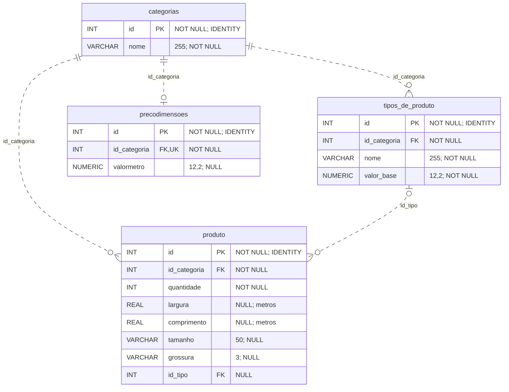
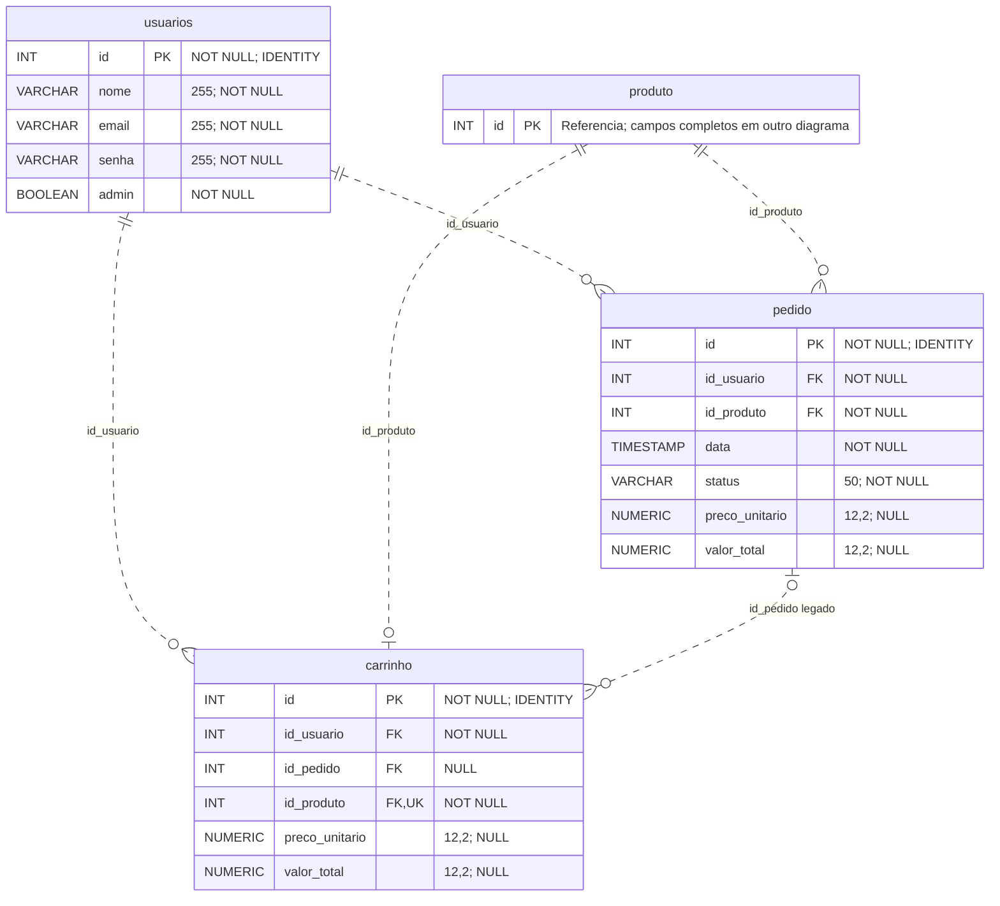
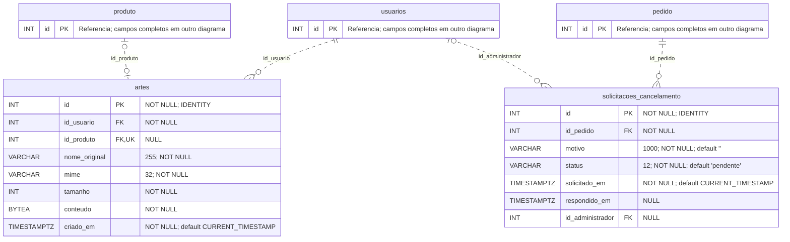

# Banco de dados do ArtUP

Diagramas conferidos em **21/10/2026** com as consultas da aplicação, as [migrações versionadas](../database/migrations/) e o catálogo do banco PostgreSQL local. A consulta ao catálogo foi executada em transação somente de leitura, sem consultar dados pessoais nem alterar tabelas. O modelo confirmado contém **9 tabelas, 50 colunas e 13 chaves estrangeiras**; não comprova o estado de outra instalação.

O [dump SQL](../database/dump_banco.sql) reúne a estrutura completa e os dados de demonstração para restauração em banco vazio, incluindo as migrações de artes e cancelamentos. O procedimento com PostgreSQL e `psql` 18.x está no [README principal](../README.md#instalação-e-configuração). As migrações individuais continuam disponíveis para bancos anteriores; elas não substituem a restauração inicial.

- [Modelo de dados e legenda](#modelo-de-dados)
- [Catálogo e preços](#catalogo-e-precos)
- [Clientes, carrinho e pedidos](#clientes-carrinho-pedidos)
- [Artes e solicitações de cancelamento](#artes-e-cancelamentos)
- [Integridade e exclusões](#integridade-e-exclusoes)
- [Parâmetros e exemplos SQL](#parametros-iniciais)

<a id="modelo-de-dados"></a>

## Modelo de dados

Os três diagramas representam o mesmo banco, separados para facilitar a leitura. Entidades indicadas como referência mostram apenas o ID; seus demais campos aparecem no diagrama correspondente. Todas as colunas confirmadas estão representadas.

- `PK`: chave primária; `FK`: chave estrangeira; `UK`: restrição de unicidade da coluna inteira.
- `||`: exatamente um; `o|`: zero ou um; `o{`: zero ou muitos.
- As linhas pontilhadas representam vínculos que não integram a chave primária da tabela dependente.
- Todos os IDs primários são `INTEGER` gerados por identidade. `VARCHAR` informa o comprimento no comentário; `NUMERIC` informa precisão e escala. `TIMESTAMP` não tem fuso; `TIMESTAMPTZ` tem fuso.

<a id="catalogo-e-precos"></a>

### Catálogo e preços



Cada categoria pode ter vários tipos e no máximo uma tarifa por m². O tipo do produto é opcional; não existe uma ligação direta entre `produto` e `precodimensoes`. As FKs de categoria e tipo são independentes; a compatibilidade entre eles é validada pela aplicação, não por uma FK composta.

As dimensões de `produto` continuam em **metros**, com tipo `REAL`; formulários e listagens usam centímetros. Tarifas e preços usam `NUMERIC(12,2)`. Consulte as [regras de cálculo](funcionalidades.md#precos).

<a id="clientes-carrinho-pedidos"></a>

### Clientes, carrinho e pedidos



Cada linha do carrinho pertence a um usuário e referencia um produto exclusivo nesse carrinho. Cada pedido representa um item confirmado e referencia um produto; o banco permite que vários pedidos referenciem o mesmo produto. Confirmar o carrinho cria os pedidos e remove as linhas do carrinho atomicamente, preservando os preços aceitos.

`carrinho.id_pedido` é uma referência **legada e opcional**; novos itens são ligados pelo produto. Ao excluir o pedido, essa coluna fica nula e o item do carrinho é preservado. Registros antigos de pedido com status `carrinho` ficam fora das listagens de pedidos confirmados.

A aplicação usa Pendente (`pendente`), Em produção (`em producao`), Retirada (`retirada`), Entregue (`concluido`) e Cancelado (`cancelado`). Esses valores são validados no PHP; `pedido.status` não possui CHECK de enumeração no banco observado. O rótulo Entregue preserva a chave `concluido`.

Não há unicidade de e-mail no banco observado. A coluna `usuarios.senha` armazena os hashes novos, mas o login ainda aceita registros legados sem hash. A página administrativa de clientes consulta `usuarios`, pedidos e carrinho; não existe tabela separada de clientes ou estatísticas.

<a id="artes-e-cancelamentos"></a>

### Artes e solicitações de cancelamento



Uma arte sempre pertence a um usuário e pode ficar sem produto enquanto é rascunho. Um produto pode ter no máximo uma arte, e uma arte pode estar vinculada a no máximo um produto. O conteúdo original fica em `BYTEA`, não na pasta `/img`.

Cada pedido pode acumular várias solicitações de cancelamento, mas somente **uma pendente por vez**, garantida por índice único parcial. Por isso `id_pedido` não é marcado como `UK` nesse diagrama. O cliente solicitante é obtido de `pedido.id_usuario`; `id_administrador` identifica quem respondeu. Não há coluna de cliente na tabela de solicitações.

Enquanto a solicitação está pendente, `respondido_em` e `id_administrador` são nulos; após aprovação ou recusa, ambos são obrigatórios por CHECK. A FK aponta para `usuarios`; a exigência de papel administrativo é feita pela aplicação. Os detalhes funcionais estão nas seções de [artes](funcionalidades.md#artes) e [pedidos](funcionalidades.md#pedidos).

<a id="integridade-e-exclusoes"></a>

## Integridade e exclusões

As regras abaixo foram confirmadas no catálogo local. `NO ACTION` impede excluir um registro ainda referenciado; a aplicação precisa tratar seus vínculos antes da exclusão.

| Chave estrangeira | Referência | ON DELETE |
| --- | --- | --- |
| `artes.id_produto` | `produto.id` | `CASCADE` |
| `artes.id_usuario` | `usuarios.id` | `NO ACTION` |
| `carrinho.id_pedido` | `pedido.id` | `SET NULL` |
| `carrinho.id_produto` | `produto.id` | `NO ACTION` |
| `carrinho.id_usuario` | `usuarios.id` | `NO ACTION` |
| `pedido.id_produto` | `produto.id` | `NO ACTION` |
| `pedido.id_usuario` | `usuarios.id` | `NO ACTION` |
| `precodimensoes.id_categoria` | `categorias.id` | `NO ACTION` |
| `produto.id_categoria` | `categorias.id` | `NO ACTION` |
| `produto.id_tipo` | `tipos_de_produto.id` | `NO ACTION` |
| `solicitacoes_cancelamento.id_administrador` | `usuarios.id` | `NO ACTION` |
| `solicitacoes_cancelamento.id_pedido` | `pedido.id` | `CASCADE` |
| `tipos_de_produto.id_categoria` | `categorias.id` | `NO ACTION` |

Produto e arte só são descartados pela aplicação quando o produto não é usado por outro pedido nem pelo carrinho. Excluir um pedido remove suas solicitações em cascata; excluir um produto remove sua arte em cascata.

| Restrição ou índice | Efeito confirmado |
| --- | --- |
| `uq_carrinho_produto` | No máximo uma linha de carrinho por produto. |
| `uq_precodimensoes_categoria` | No máximo uma tarifa por categoria. |
| `artes_id_produto_key` | No máximo uma arte por produto; rascunhos com produto nulo são permitidos. |
| `uq_cancelamento_pendente` | Unicidade de `id_pedido` somente quando a solicitação está pendente. |
| `idx_cancelamentos_pedido` | Consulta do histórico por `id_pedido, id DESC`. |
| `idx_artes_rascunhos_data` | Índice por `criado_em` somente para artes sem produto. |

As artes possuem CHECK para MIME permitido, tamanho de 1 a 10.485.760 bytes e igualdade entre tamanho informado e comprimento do `BYTEA`. As solicitações aceitam somente `pendente`, `aprovado` e `recusado`. Os preços de carrinho e pedido possuem CHECK não negativo, permitindo `NULL` para valores ainda ausentes. Esses controles não substituem as validações adicionais do PHP.

O dump já contém as tabelas base, [001_artes.sql](../database/migrations/001_artes.sql) e [002_cancelamentos.sql](../database/migrations/002_cancelamentos.sql). Para aplicar somente essas migrações em um banco anterior, as tabelas base precisam existir. Os diagramas documentam o estado confirmado; não criam nem modificam o schema.

<a id="parametros-iniciais"></a>

## Parâmetros e exemplos SQL

Os exemplos abaixo foram incorporados do antigo arquivo `parametros_principais.pgsql`. São consultas e inserções de referência, não uma migração nem um seed idempotente. Os INSERTs pressupõem as categorias 1 = adesivos, 2 = papelaria, 3 = placas e 4 = banners; repetir as inserções pode duplicar dados. Revise o banco antes de executar qualquer trecho.

```sql
SELECT * FROM precodimensoes;
Select * FROM produto;
SELECT * FROM tipos_de_produto;
select * from categorias;
SELECT * FROM usuarios;


INSERT INTO categorias (nome) VALUES ('adesivos'), ('papelaria'), ('placas'), ('banners');
INSERT INTO tipos_de_produto (id_categoria, nome, valor_base) VALUES
(1, 'BOPP', 5.00),
(1, 'Vinil', 7.50),
(1, 'Vinil-UV', 10.00),

(4, 'PVC', 2.00),
(4, 'Barra-de-madeira', 3.00),
(4, 'Barra-de-aluminho', 4.00),
(4, 'Ilhós', 2.50),

(2, 'Sulfite', 0.50),
(2, 'Fotográfico', 1.50),
(2, 'Couché', 1.00),
(2, 'Offset', 0.75);

INSERT INTO precodimensoes (id_categoria, valormetro) VALUES
(1, 0.10),
(2, 0.05),
(3, 0.15),
(4, 0.20);

SELECT valormetro FROM precodimensoes WHERE id_categoria = 1;
```
