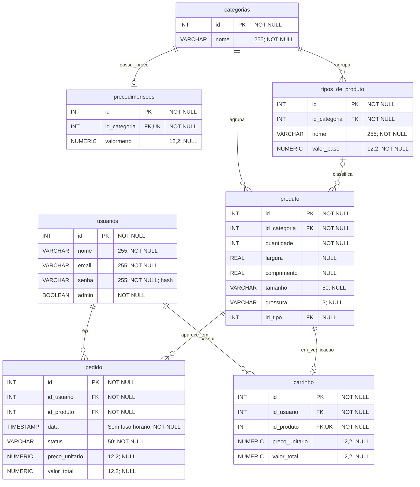

# ArtUP — modelo PostgreSQL

Este diagrama resume o modelo base de produtos, carrinho e pedidos. `PK` significa chave primária, `FK` chave estrangeira e `UK` valor único. Os IDs são gerados automaticamente. As tabelas adicionais de artes e cancelamentos são definidas nas [migrações atuais](../database/migrations/); o checkout ainda precisa de uma baseline de produção completa, conforme a [auditoria](auditoria.md).

Cada pedido referencia **um produto**. Cada linha de `carrinho` guarda um produto do cliente em verificação, ainda sem pedido. Ao clicar em **Confirmar pedidos**, a aplicação cria um pedido com status `pendente` para cada item do carrinho e remove essas linhas do carrinho. A transferência é atômica: uma falha mantém todos os itens em verificação. Excluir um item antes da confirmação descarta seu produto, desde que ele não seja usado por outro carrinho ou pedido.

A coluna antiga `carrinho.id_pedido` fica opcional como referência histórica; novos itens usam somente `id_produto`. Os registros antigos com status `carrinho` ficam fora das listagens de pedidos confirmados. Os scripts antigos de criação/conversão do schema não estão no checkout atual; as migrações de artes e cancelamentos pressupõem as tabelas base e as colunas de preço existentes. A mudança da interface para centímetros não exige migração nem reescrita dessas medidas armazenadas.

O preço por m² pertence à categoria, que pode ter zero ou um registro em `precodimensoes`. O produto acessa esse preço pela categoria; não existe uma relação direta 1:1 entre produto e preço. Uma categoria pode ter vários tipos de produto, e o tipo de um produto é opcional. As dimensões continuam armazenadas em metros; formulários e listagens convertem para centímetros, conforme [precos.md](precos.md).

Os nomes aparecem em minúsculas porque o PostgreSQL converte identificadores sem aspas para minúsculas. As colunas antigas `tipo` e `acabamento` podem permanecer em bancos anteriores durante a transição, mas não fazem parte deste modelo.
