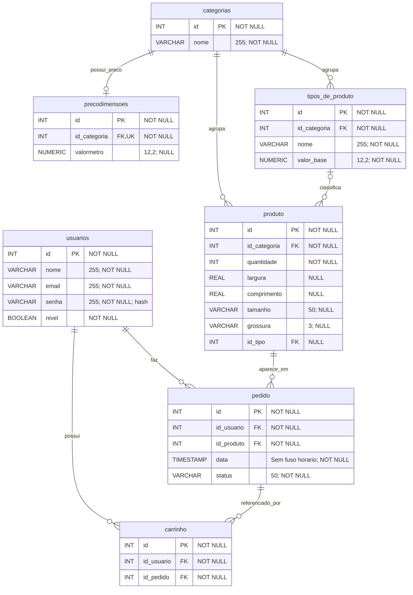

# ArtUP — modelo PostgreSQL

Este diagrama corresponde às tabelas de [SQL_tabelas.pgsql](SQL_tabelas.pgsql). `PK` significa chave primária, `FK` chave estrangeira e `UK` valor único. Os IDs são gerados automaticamente.

Cada pedido referencia **um produto**. Cada carrinho referencia **um pedido** e acessa seu produto por essa relação. Para permitir vários produtos no mesmo pedido ou carrinho, será necessário um modelo com tabelas de itens.

O preço por metro pertence à categoria, que pode ter zero ou um registro em `precodimensoes`. O produto acessa esse preço pela categoria; não existe uma relação direta 1:1 entre produto e preço. Uma categoria pode ter vários tipos de produto, e o tipo de um produto é opcional.

Os nomes aparecem em minúsculas porque o PostgreSQL converte identificadores sem aspas para minúsculas. As colunas antigas `tipo` e `acabamento` podem permanecer em bancos anteriores durante a transição, mas não fazem parte deste modelo.
